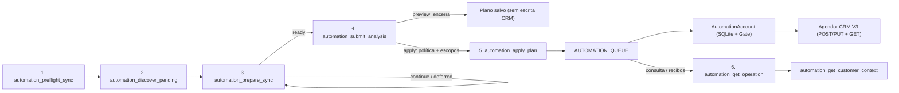

# Arquitetura do Sistema

`elo-agendor-mcp` é um Worker TypeScript executado na Cloudflare Workers que expõe um servidor MCP remoto com OAuth 2.1, estado durável em Durable Object SQLite, fila assíncrona de execução e adaptadores tipados para Agendor CRM V3 e Agendor Chat V1. A interpretação das conversas ocorre no cliente agente MCP conectado; o backend coordena identidade, catálogo, política, orçamento e execução recuperável.

## Camadas atuais

```text
src/
├── index.ts                 # Entrada do Worker (fetch, queue, scheduled) e rate limit OAuth
├── app/config/tenant.ts     # Constantes centralizadas de tenant (conta 'elotenant', inboxes 4101/4102, Chat account '7001', serviço)
├── shared/                  # Utilitários transversais (errors, http, cancellation, rate-limit, canonical, json) e contratos puros em contracts/
├── oauth/                   # OAuth 2.1 (@cloudflare/workers-oauth-provider) + Access OIDC JWKS
├── auth.ts                  # Contexto OAuth verificado e escopos
├── mcp/                     # Fábrica createServer por requisição, segurança de tools e limite 512 KiB
├── agendor/
│   ├── ports.ts             # Interfaces obrigatórias BudgetGate e InboxGuard injetadas nos clientes
│   ├── crm/                 # Cliente HTTP tipado do Agendor CRM V3, catálogo e mutações
│   └── chat/                # Cliente HTTP somente leitura do Agendor Chat V1, transporte, paginação e anexos
├── domain/                  # Regras puras (identity, identity-candidates, identity-duplicates, demands, planner, planner-demand, fields, stages, policy-types, authorization, inbox-policy, reviews) e schemas/
└── automation/
    ├── clients.ts           # Factory concreta que injeta budget gate do DO e allowlist nos clientes Agendor
    ├── service.ts           # Fachada createAutomationService compondo os casos de uso com WorkflowContext
    ├── schemas/             # Schemas Zod por contexto (preparation, execution, context, operations) + barrel schemas.ts e types.ts (z.infer)
    ├── usecases/            # Casos de uso (preflight, discover, prepare, prepare-steps, prepare-hydration, submit, apply, reviews, reprocess, audit, context, status, policy)
    ├── execution/           # Execução recuperável (executor, queue, reconciliation, verification-reader, maintenance)
    ├── discovery.ts         # Descoberta incremental de conversas pendentes (T01)
    ├── ingress.ts           # Endpoint opcional /automation/chat-events (desabilitado por padrão)
    ├── context/             # Projeção e renderização Markdown do contexto do cliente
    └── state/               # Durable Object AutomationAccount, migrations SQLite, repository, agregados repositories/ e budget
```

> Nota: As fronteiras entre camadas (`import-x/no-restricted-paths`), o bloqueio de acoplamentos proibidos (`no-restricted-imports`) e o limite `max-lines: 400` em todo `src/` são aplicados como `error` no ESLint: `domain/` permanece puro (sem importar `agendor/`, `automation/`, `mcp/`, `oauth/` ou `env`), `agendor/` não importa `automation/` nem `domain/`, `automation/state/` não executa regras de domínio, e `mcp/` não importa `automation/state/`, `automation/execution/` nem `oauth/`.

## Fluxo principal de automação



1. **`automation_preflight_sync` (somente leitura)**: verifica ator OAuth, modo efetivo e versão da política no DO, allowlist efetiva, recorte `inboxIds`, limites e disponibilidade do SQLite/lease. Não reserva lease, não consome orçamento do Agendor e não acessa Chat ou CRM. Retorna `ready_for_scope_check`, `ready_for_discovery` (para `target.kind = "pending"`) ou `blocked`.
2. **`automation_discover_pending`**: consulta o inventário completo de inboxes do Chat antes de cada página e exige exatamente `[4101, 4102]` sem duplicatas ou paginação restante. Lê uma página por chamada de uma caixa autorizada (janela de 7 dias, até 100 conversas/página e 10 páginas/caixa), persiste cursor opaco (expira em 30 min) e eventos `pending_activity` em SQLite, e devolve metadados `candidates[].prepare` sem expor mensagens ou anexos.
3. **`automation_prepare_sync`**: reserva ou renova um `WorkLease` (600 s) com `fence` monotônico e trava de preparação (`preparation_locks`, expiração de 60 s). Valida o inbox canônico antes das leituras de conteúdo, coleta mensagens (`after`), metadados de anexos, contato individual (`crmPersonId`), candidatos e catálogo CRM. Pode retornar `continue` ou `deferred` com `retryAt` e cursor vinculados ao trabalho e cliente OAuth; cinco adiamentos sem avanço bloqueiam a preparação. Em `ready`, grava manifesto e snapshot em uma transação SQLite.
4. **`automation_submit_analysis`**: valida ator, lease, revisões exatas de snapshot/contexto e fontes citadas. Persiste análise estruturada, projeção pendente de contexto e plano determinístico (`SyncPlan`). Em modo `preview`, o fluxo termina aqui sem escrever no CRM.
5. **`automation_apply_plan`**: exige `policy.mode === "apply"`, `policyVersion` atual, `nativeCreatorDisabled === true` quando existir comando `create_person`, e todas as capacidades CRM derivadas de cada comando do plano no token OAuth do chamador. Gera `AuthorizedPlan` com validade máxima de 300 segundos (limitada à expiração do ator), reserva os comandos com fencing e enfileira uma referência mínima na `AUTOMATION_QUEUE`.
6. **`automation_get_operation` e `automation_get_customer_context`**: acompanham recibos e estados (`queued`, `applied`, `review`, `uncertain`, `expired`). Quando todos os comandos da operação são confirmados por leitura (`GET`), o contexto Markdown do cliente (limite de 32 KiB UTF-8, template em [cliente-contexto.md](templates/cliente-contexto.md)) é publicado de forma idempotente com controle de versão.

Ferramentas CRM diretas (`crm_create_*`, `crm_enrich_*`, `crm_update_task` e as 4 `crm_update_*` legadas) convertem entradas estritas em comandos tipados no mesmo executor (`executeDirectCommand`) e passam pelo mesmo gate de orçamento, reserva e conferência por `GET`.

## Durable Object `AutomationAccount`

`accountState(env)` resolve sempre o singleton lógico `env.AUTOMATION_STATE.getByName('elotenant')`. Nenhum chamador HTTP pode escolher outra conta.

- **SQLite e migrations**: `migrate(ctx.storage)` executa no construtor dentro de `blockConcurrencyWhile` e mantém 8 versões numeradas em `schema_migrations`:
  - **v1**: `account_binding`, `customers`, `bindings`, `identity_reservations`, `events`, `work`, `snapshot_manifest`, `demands`, `facts`, `contexts`, `plans`, `commands`, `reviews`, `outbox`, `policy`, `budget`, `budget_clock`.
  - **v2**: metadados de base em `plans` (`fence`, `snapshot_version`, `context_version`, `catalog_version`).
  - **v3–v4**: associação imutável `work_customers` entre trabalho e cliente.
  - **v5**: ledger de execução recuperável (`execution_operations`, `execution_commands`).
  - **v6**: entrega (`operation_delivery`), tombstones permanentes (`execution_tombstones`), auditoria (`operational_audit`) e dicas (`chat_hints`).
  - **v7**: descoberta incremental (`pending_cursors`, `pending_activity`).
  - **v8**: trava de concorrência por trabalho (`preparation_locks`).
- **Transações curtas**: reservas, fencing e CAS usam blocos síncronos curtos `transactionSync`; cálculo de hashes e chamadas de rede permanecem fora das transações.
- **Vínculo de conta**: a ativação vincula os IDs verificados de CRM e Chat em `account_binding`; divergência falha com `ACCOUNT_RECONFIGURATION_REQUIRED`.

## Fila, execução recuperável e DLQ

- **Fila**: `AUTOMATION_QUEUE` (`elo-agendor-operations`), configurada em `wrangler.jsonc` com `max_batch_size: 1`, `max_concurrency: 1`, `max_retries: 4` (5 entregas totais: 1 inicial + 4 retries) e Dead Letter Queue `elo-agendor-operations-dlq`.
- **Envelope mínimo**: a mensagem da fila carrega somente `{ accountKey: "elotenant", operationId, version }`, sem tokens OAuth, credenciais Agendor ou corpos de clientes.
- **Revalidação e envio (`createQueueExecutionDeps` / `resumeOperation`)**: antes de cada escrita no CRM, o consumidor verifica a política atual, o inbox canônico de todas as conversas associadas, os hashes das fontes (`message`, `contact`, `crm`) e os valores `before` observados no registro alvo. Após `POST`/`PUT`, confirma o efeito com `GET` antes de marcar o recibo como `confirmed`.
- **Retries e incerteza**: apenas rejeições conhecidas `429` permitem nova tentativa automática (respeitando `Retry-After` ou backoff de `10`, `20`, `40`, `80` e `160` segundos, limitado a 5 tentativas no ledger de execução). Timeout, erro desconhecido ou abandono de token de envio (> 30 s) preserva a reserva como `uncertain` e permite apenas reconciliação por `GET`, nunca repetição automática de `POST`. Esgotar as 4 redeliveries envia a mensagem à DLQ, mantendo o estado recuperável no DO.

## Cron de 5 min e watchdog

- **Cron**: `triggers.crons = ["*/5 * * * *"]` chama `scheduled()` → `accountState(env).maintainAccount(Date.now())`.
- **Alarme do DO**: `AutomationAccount` também agenda `ctx.storage.setAlarm` com intervalo `WATCHDOG_INTERVAL_MS = 300_000` (5 min), rearmando o alarme **antes** de enviar mensagens à fila para evitar que falhas transitórias da fila deixem trabalho pendente sem alarme.
- **Responsabilidades de `maintainAccount`**:
  1. Expirar evidências, snapshots, demandas, fatos, contextos, revisões, eventos e hints após **90 dias**, preservando `execution_tombstones` e deduplicação.
  2. Expirar reservas de envio abandonadas e liberar reconciliação segura.
  3. Republicar na `AUTOMATION_QUEUE` referências vencidas de operações em `queued` ou `uncertain`.
- O watchdog **nunca** interpreta conversas, não aciona agentes e não renova autorizações expiradas (que expiram em até 5 minutos).

## Gate de orçamento único (C13)

Toda requisição HTTP real para o Agendor — incluindo ferramentas diretas de leitura/escrita MCP, preparação de automação, listagem de discovery, download de anexos e verificação em fila — passa obrigatoriamente por `takeBudget` no DO `AutomationAccount`.

- **Limite**: **4 reservas por janela móvel de 10.000 ms por produto** (`crm` e `chat` possuem cotas independentes).
- **Relógio monotônico**: a tabela `budget_clock` garante avanço monotônico (`now = max(now, last_now)`) contra regressão de relógio.
- **Irrevogável**: uma reserva consumida não é reembolsada mesmo que a requisição upstream seja cancelada ou falhe.
- **Comportamento ao exceder**: a 5ª tentativa na janela recebe `{ allowed: false, retryAt }`, convertida em `BudgetDeferredError` (`UPSTREAM_RATE_LIMITED`, HTTP `429` com `Retry-After`) ou adiamento explícito na preparação. Se o DO estiver indisponível, falha fechada (`UPSTREAM_UNAVAILABLE`, HTTP `503`).
- **Limitação arquitetural registrada (C13)**: como até leituras diretas concorrentes serializam por esse DO único, a vazão máxima global da instalação é estritamente limitada a 4 req/10s por produto, protegendo as credenciais compartilhadas do Agendor contra rajadas. Veja [ADR-005](decisions/ADR-005-budget-compartilhado-no-do.md).
