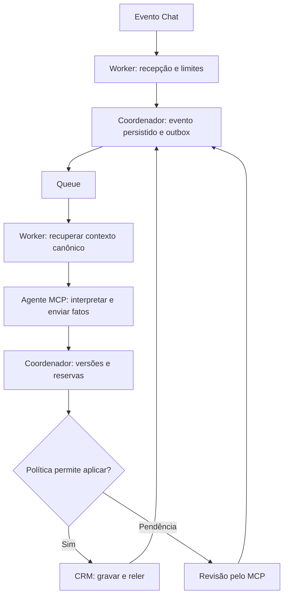

# Automação Agendor Chat → Agendor CRM da Elo

Data: 2026-10-23, America/Cuiaba.
Revisão: 2026-10-26, America/Cuiaba.
Estado: proposta revisada; interpretação pelo agente MCP confirmada; processamento sob demanda por chamadas MCP e contexto persistente por cliente; aprovação do documento pendente.
Revisão de implementabilidade atual concluída em 2026-10-26: fluxo por agente MCP e contexto por cliente coerentes, sem dependência da API da OpenAI. O acionamento principal foi esclarecido como processamento sob demanda pelo agente via MCP; agendamento é opcional. Permanecem aprovações comerciais do desenho.

## 1. Objetivo e decisões confirmadas

Transformar pedidos de serviços/análises do Agendor Chat em cadastros de clientes e negócios no Agendor CRM, completando os registros conforme a conversa evolui. O negócio é o foco principal, acompanhado de empresas, pessoas e próximas ações.

O usuário definiu:

- Pedido explícito de serviço/análise com alguns dados identificáveis do cliente já permite registrar a demanda. Os dados podem chegar junto ou depois. Não se exige ficha comercial completa.
- Se o cliente iniciou a abordagem que gerou a demanda, usar **Passivo**; se a Elo iniciou, usar **Ativo**.
- A etapa acompanha o conteúdo da conversa: **Nova solicitação**, **Elaborando proposta**, **Análise interna (aprovação)** e **Proposta enviada**.
- A aprovação interna acontece **dentro da Elo**.
- A solução escolhida centraliza persistência, validação e execução das operações no backend atual. O agente conectado ao MCP interpreta as conversas e usa o backend para registrar os resultados.
- O usuário confirmou a interpretação pelo próprio agente MCP e sugeriu, se viável, contexto persistente por cliente em arquivo Markdown ou formato equivalente.
- O fluxo principal é acionado quando o agente solicita processamento pelo MCP; não depende de agenda nem de manter este computador ligado para que o servidor remoto responda.
- Não será usada a API da OpenAI, conforme definição do usuário em 2026-10-26. Nenhum provedor substituto está escolhido.

Os demais comportamentos são propostas técnicas para revisão, não decisões adicionais atribuídas ao usuário.

## Resumo das escolhas propostas para aprovação

- Ampliar o Worker atual com fila de processamento e estado SQLite por conta.
- O próprio agente conectado ao MCP interpreta as conversas, sem chamadas do backend à API da OpenAI.
- Manter um documento Markdown por cliente no backend, disponível via MCP, derivado de fatos estruturados e atualizado com controle de versão. Uma cópia local é opcional; não é necessária para compartilhar contexto entre clientes MCP.
- Registrar o pedido assim que identificável; se a origem da abordagem continuar incerta, manter pendência antes da criação CRM para evitar funil incorreto.
- Processar também pedido anterior à ativação quando uma mensagem nova trouxer informação relevante que permita registrá-lo; não importar histórico em massa.
- Usar o atendente como responsável quando houver correspondência segura e preservar alterações manuais observáveis. Há limitação residual contra edição externa simultânea, detalhada adiante.
- Exigir uma única rotina de criação por caixa/escopo no piloto e na ativação geral.
- Validar primeiro em simulação, depois operar automaticamente nos casos claros.

## 2. Abordagens consideradas

| Abordagem | Funcionamento | Consequência |
|---|---|---|
| Integração nativa + enriquecimento | Agendor faz o cadastro inicial; nosso serviço complementa informações | Exige coordenação entre duas origens de criação e limita o controle do gatilho |
| Backend próprio no projeto atual — escolhida e detalhada | Agente MCP interpreta; backend coordena, valida e cria/completa registros | Uma regra única de persistência e escrita; execução da interpretação depende do agente |

O usuário escolheu a segunda. Na migração, identificar e coordenar a integração nativa para evitar duas rotinas criando a mesma demanda.

## 3. Situação atual e contratos

O projeto `elo-agendor-mcp` é um Worker TypeScript com OAuth do proprietário e endpoint `/mcp`. Existem 15 ferramentas, incluindo leitura do Chat e atualizações limitadas de registros CRM existentes. KV armazena OAuth; não há banco de demandas nem executor de eventos.

Constatações:

- Chat: as ferramentas retornam até 25 conversas/20 mensagens e omitem telefone, e-mail, anexos e atributos adicionais. A coleção Postman mostra contatos, anexos, webhooks e `after` nas mensagens. Sua semântica e a cobertura de histórico/listagem precisam de validação.
- CRM: a API documenta criação, atualização ampliada, produtos, tarefas e metadados. As buscas atuais não expõem todos os filtros disponíveis, incluindo CNPJ, telefones e `withCustomFields`.
- Um negócio tem vínculo principal com empresa **ou** pessoa. Alterar `relatedEntity` substitui o vínculo anterior; não presumir dois vínculos principais simultâneos.
- `dealStage` na escrita é a **sequência da etapa**, e `funnel` é ID do funil.
- A coleção pública do Chat não estabelece suficientemente respostas, eventos, autenticação de webhook ou paginação. Não copiar contratos de outro produto.

A descoberta usa documentação e GETs delimitados, com saída sanitizada. Escrita é verificada com mocks; um piloto real terá registros/operações delimitados antes da ativação.

## 4. Gatilho, identidade mínima e pendências

Estados internos: `aguardando_dados`, `pronta`, `processando`, `sincronizada`, `revisao`, `repeticao_agendada`, `resultado_incerto` e `pausada`.

Uma demanda fica registrada internamente assim que há solicitação explícita de serviço identificável com dados do cliente. A criação CRM pode seguir quando esses dados permitem cadastro válido. Proposta de exceção a aprovar: se não for possível determinar Ativo/Passivo, conservar o pedido como pendência de origem antes de criar o negócio, pois não há um funil neutro definido. Essa pendência deve aparecer no estado operacional, sem ocultar o pedido.

Interpretação proposta: orçamento de serviço definido já conta como solicitação comercial; não precisa aguardar contratação. Saudação, pergunta genérica ou atendimento de pedido antigo não geram outro negócio automaticamente.

Nome/empresa, telefone, e-mail, documento ou vínculo existente podem identificar o cliente; dados do contato Chat também contam. Não exigir todos esses dados nem CNPJ em qualquer cadastro. Se a API exigir nome e não existir nome verificável ou cadastro existente, salvar o pedido internamente e indicar esse requisito, sem inventar identidade para contornar a API.

Preço, endereço completo e detalhes técnicos adicionais podem ficar pendentes quando não obrigatórios na etapa. Zero eventualmente aplicado pela API deve ser distinguido de preço informado, no estado da automação.

## 5. Resolução de clientes e demandas

Prioridade: vínculo Chat–CRM validado → CNPJ da empresa/identificador inequívoco da pessoa → e-mail/telefone com nome e contexto → nome como candidato. Número compartilhado e homônimos geram revisão. Filtros por prefixo exigem igualdade normalizada do retorno. Percorrer as páginas necessárias antes de declarar ausência; não escolher o primeiro resultado.

Upserts têm critérios próprios: empresa por nome/CNPJ; pessoa por CPF/e-mail. Não tratá-los como deduplicação por telefone. Preferir localizar, reservar identidade e criar/atualizar explicitamente.

Criar empresa quando houver evidência de organização contratante. Criar pessoa com dados identificados e vincular à empresa quando a relação estiver explícita. Se somente a pessoa for identificada, negócio pode começar ligado a ela. Migrar depois para empresa apenas com relação inequívoca e política revisada; ambiguidades vão para revisão.

Cada demanda recebe `demandId` permanente do backend. Uma conversa pode ter vários pedidos; um pedido pode reunir vários serviços e conversas/contatos. Usar referências de pedido/proposta, local/projeto e distinção explícita de solicitações. Mesmos cliente e serviço não provam identidade do pedido. Complemento/correção atualiza a demanda existente; nova solicitação independente cria outra. Associação incerta suspende somente a decisão afetada.

Reservas persistentes de identidade/criação abrangem conversas diferentes da conta. Antes do POST, pesquisar novamente registros e negócios relevantes, inclusive criações de vendedores ou da integração nativa.

## 6. Funil, etapa e responsável

A origem é a abordagem que gerou a demanda, não o remetente mais recente nem a primeira mensagem de uma conversa antiga. Pedido novo iniciado pelo cliente em conversa antiga pode ser Passivo; resposta à prospecção pode ser Ativo. Sem contexto suficiente, pendência de origem; não escolher o funil padrão silenciosamente. Funil de negócio existente permanece estável, com correção conflitante sujeita a revisão.

| Etapa | Evidência |
|---|---|
| Nova solicitação | Pedido registrável sem evidência de preparação posterior |
| Elaborando proposta | Equipe da Elo indica preparação do orçamento/proposta daquela demanda |
| Análise interna (aprovação) | Proposta ou condições aguardam aprovação dentro da Elo |
| Proposta enviada | Mensagem/anexo de saída comprova envio da proposta correspondente; promessa de enviar não basta |

PDF recebido do cliente, proposta antiga ou mensagem de terceiro não comprovam envio da Elo. Nota interna pode ser evidência, preservando autoria. Aprovação do cliente não define aprovação interna. A automação registra o andamento; não concede aprovação comercial/financeira.

O negócio pode nascer na etapa posterior comprovada. Não simular passagem por todas as etapas. Evidência antiga não regride etapa. Refação explícita gera sugestão de retorno e revisão na primeira versão. Aprovação interna concluída, ainda sem envio, permanece nessa etapa até o envio.

Mapear nomes lógicos para IDs reais de funis e sequência das etapas. Validar ambos os funis/quatro etapas e requisitos antes de ativar. Usar `checkRequiredFields: true` onde documentado; rejeição vira pendência.

Responsável proposto: atendente atual com correspondência única a usuário CRM ativo, preferencialmente por e-mail. Preservar responsável existente. Sem correspondência, permitir cadastro sem responsável quando a API permitir e abrir pendência; não atribuir ao proprietário da integração por padrão.

Ganhos/perdidos não são reabertos ou movimentados automaticamente. Estas quatro etapas não autorizam ganho/perda automático.

## 7. Preenchimento e preservação

Separar dados de empresa, pessoa e pedido. Local de coleta não substitui endereço cadastral. Solicitante, destinatário da proposta e aprovador podem ser pessoas diferentes.

Consultar catálogo real: funis/etapas, usuários, produtos, categorias, setores, origens, cidades e campos personalizados. Incluir valores atuais com `withCustomFields` onde documentado. Não presumir que as definições exponham toda obrigatoriedade por etapa.

| Registro | Dados propostos |
|---|---|
| Empresa | Nome/razão social, documento informado, contatos, endereço cadastral, classificações e campos mapeados |
| Pessoa | Nome, função, contatos, empresa relacionada e campos mapeados |
| Negócio | Título, escopo resumido, serviços/itens, quantidade/unidade, preço/desconto conhecido, valor, responsável, funil/etapa e campos mapeados |
| Próxima ação | Tarefa com vínculo, responsável/prazo, baseada em compromisso explícito ou regra configurada |

Campos de análises, amostras, coleta, logística, pagamento e prazos dependem do catálogo real. Não criar campos personalizados no CRM automaticamente. Informação sem destino fica no resumo/pendência.

Usar produto ativo e inequívoco. Distinguir quantidade de amostras da unidade do produto. Validar desconto/total; preservar logística já incluída e preços não alterados. Serviço claro com produto ambíguo permite registrar escopo e pendência do item.

Escrever patches autorizados, sem campos ausentes. Verificar se coleções de itens/campos personalizados são mescladas ou substituídas e preservar valores não afetados. Dados novos podem preencher vazio ou corrigir valor anterior da automação com evidência explícita.

Guardar última versão escrita por campo. Divergência observada no CRM marca alteração externa e bloqueia o patch afetado até resolução. A preservação é de melhor esforço contra edições humanas externas simultâneas: sem atualização condicional no Agendor, um valor pode mudar entre nossa releitura e escrita e não ser detectável. Não apresentar essa proteção como garantia absoluta. Oferecer bloqueio manual de campos/demandas e auditoria dos valores efetivamente observados. Descrição humana é mantida; resumo automático usa região gerenciada identificável, respeitando limite sem truncar conteúdo humano. Histórico detalhado fica no estado com referência às mensagens.

Datas relativas usam timestamp da mensagem e America/Cuiaba; ambiguidade vira pendência. Moeda, telefone, documento e unidade são validados pela camada determinística. Formatos de documento acompanham a API atual, sem pressupor CNPJ exclusivamente numérico. Notas de linha do tempo só com rota documentada/validada; tarefa não se passa por nota.

## 8. Interpretação pelo agente conectado ao MCP

Decisão confirmada: o próprio agente conectado ao MCP interpreta as conversas; o backend não chama a API da OpenAI. Não há chave, SDK ou conta da API como requisito do projeto. O agente usa o produto/conexão que o usuário já utiliza; isso não implica execução ilimitada ou isenção dos limites do produto.

Fluxo proposto:

1. Agente autenticado solicita preparar/sincronizar um cliente ou consultar trabalho pendente. Essa chamada atualiza o contexto necessário por leituras verificadas do Chat/CRM e aproveita eventos já persistidos, com versão e lease.
2. Backend prepara e reserva um lote limitado. Webhook é uma otimização de ingestão, não requisito para começar um atendimento sob demanda; limites de cobertura da leitura continuam explícitos.
3. Backend entrega contexto do cliente, demandas pertinentes, catálogo reduzido e mensagens novas, com ID/data/autoria e indicação de cobertura.
4. Agente interpreta e envia fatos/proposta estruturada com fontes e versão esperada.
5. Backend valida identidade, evidências referenciadas, campos, tipos e política; executa somente as operações permitidas.
6. Backend relê o CRM, registra resultados e atualiza contexto/checkpoints. Agente confere o resultado e relata pendências.

O fluxo principal acontece durante a execução de qualquer agente autorizado que utilize as ferramentas de processamento do MCP. Não exige agenda. O servidor devolve contexto e mensagens, o agente interpreta, e uma chamada posterior entrega a análise para validação/aplicação. O servidor não inicia inferência por conta própria. O backend remoto e os contextos permanecem acessíveis independentemente deste computador; o agente precisa de seu próprio ambiente de execução disponível quando fizer as chamadas.

Uma conexão MCP, descoberta de ferramentas, status ou consulta puramente informativa não implica autorização para alterar CRM. As ferramentas de leitura mantêm sua semântica; podem indicar que existe contexto/trabalho relacionado. As ferramentas específicas do fluxo e suas instruções orientam a sequência. O cliente agente precisa efetivamente executar a leitura, análise e submissão: uma requisição isolada não substitui essas etapas. Agendamento só será discutido se o usuário quiser processamento sem iniciativa de um agente em atendimento.

O contrato de análise inclui pedidos identificados, demanda candidata, serviço/escopo, fatos por entidade, origem, evidências de etapa, compromissos, referências, ambiguidades e contexto incompleto. Cada fato admite desconhecido. Uma classificação de confiança não autoriza escrita por si só.

Preparar somente contexto necessário; normalizar identificadores localmente quando possível. Não enviar credenciais nem base completa de clientes. A análise é autenticada, vinculada à conta, ao trabalho reservado e ao snapshot atual. O backend verifica referências/tipos/política; validade do JSON não comprova correção semântica. O agente segue as regras de evidência e ambiguidades; análise sem suporte suficiente vira pendência.

Plano e contexto antigos não autorizam novas alterações: versão divergente exige recarregar/reanalisar. Texto do cliente, anexos e memória Markdown são dados, nunca autorização para mudar permissões ou política.

Anexos são lidos por capacidades disponíveis ao agente e por metadados do Chat verificados. Aceitar somente origens Agendor/CDN verificadas e limites de tipo/tamanho/redirecionamento. Cobertura de PDF/imagem/áudio precisa ser verificada no cliente MCP escolhido. Sem ferramenta de leitura/transcrição disponível, registrar a lacuna; não acrescentar uma API externa silenciosamente.

Arquivos brutos são transitórios. Nome/MIME isolados não comprovam proposta enviada.

## 8.1. Contexto persistente por cliente

É viável manter um documento Markdown por cliente, com persistência no backend e acesso pelo MCP. Proposta: documento lógico `clientes/<customerId>/contexto.md`, acompanhado dos fatos estruturados que o originam. Não depende do disco do computador do usuário nem exige R2 apenas para pequenos textos; uma tabela `customer_contexts` no SQLite guarda documento, versão e metadados. O nome é uma chave interna gerada pelo servidor, não um caminho arbitrário fornecido pelo agente.

`customerId` é estável e opaco, criado pelo backend; mapas associam IDs de empresa/pessoa/contatos/conversas. Usar nome do cliente como chave é inadequado por homônimos e renomeações. Em venda empresarial, contexto reúne a empresa e seus contatos; contatos que representam empresas distintas não fazem os históricos dessas empresas se misturarem. Identidade ainda não resolvida recebe contexto provisório, consolidado apenas após resolução auditada.

Conteúdo do documento:

- Identificação confirmada, vínculos CRM e contatos relevantes.
- Preferências confirmadas com origem/data, distinguindo regras permanentes de condições de um pedido específico.
- Demandas ativas com IDs de negócio, serviços, etapa/funil, próximos passos e campos pendentes.
- Histórico comercial resumido, correções e informações substituídas.
- Referências a mensagens/atributos/registros, data de verificação e versão do contexto.
- Ambiguidades separadas de fatos confirmados.

O modelo de estrutura está em `docs/templates/cliente-contexto.md` e não contém dados reais. Cliente com muitas demandas mantém resumo curto e obtém detalhes de uma demanda sob demanda; não carregar indefinidamente todo o histórico.

Os registros atuais do CRM e mensagens canônicas orientam reconciliação; o Markdown resume o último estado conhecido. Antes de alterar campos mutáveis, reler o CRM e buscar o delta do Chat. Nenhum dado antigo do arquivo substitui silenciosamente informação atual.

O agente propõe fatos e correções estruturados com fontes; o backend aplica controle de versão e renderiza o Markdown. Não aceitar sobrescrita livre do documento como se fosse confirmação de campos. Resultados de escrita só aparecem como executados após conferência do CRM; sugestões continuam pendentes.

Atualização usa `expectedContextVersion`: conflito obriga recarregar e reconciliar, evitando perda de mudanças entre agentes. IDs/referências de mensagens e vínculos também ficam no estado estruturado, sem depender exclusivamente do Markdown.

Cópia local/exportação em `.md` pode ser oferecida. Ela é um espelho e não uma segunda fonte independente de escrita. Quando implementada, documentos com dados reais devem ficar em diretório de execução fora do versionamento Git; o template sanitizado pode ser versionado.

Retenção e acesso acompanham a política da seção 13. Contexto não contém tokens ou instruções executáveis; citações de cliente permanecem como dados não confiáveis.

## 9. Arquitetura

Estender Worker atual, reaproveitando adaptadores, Zod, OAuth e erros. Acrescentar **Cloudflare Queues** e **Durable Object SQLite por conta Agendor**. A Queue prepara trabalho e o agente MCP o interpreta quando acionado. O resultado autenticado retorna ao backend para validação e escrita. Chamadas Agendor acontecem fora das transações do coordenador.

O objeto por conta coordena identidades, demandas, operações e orçamento de chamadas; não é um objeto global de todos os clientes. Não manter `blockConcurrencyWhile` durante rede ou interpretação. Reservas e versões persistentes coordenam escritores do backend.

Tabelas conceituais: events, outbox, conversation_checkpoints, demands, customer_bindings, customer_contexts, identity_reservations, field_facts, operations, reviews, catalog_snapshots, policy e request_budget.

Evento recebe chave única e revisão, incluindo edição/exclusão quando disponíveis. Confirmar recebimento somente após persistir e agendar despacho. Alarme publica referências internas na Queue; falha entre envio e marcação conserva a chave no reenvio. Fatos/transcrições completas não entram na Queue.

Consumidor admite repetição e desordem e prepara trabalho interpretável. Agente recebe snapshot/revisão ao reservar; backend aceita análise e reserva alterações apenas se versão e lease continuam válidos. Operações recebem lease, fencing token e checkpoints. Expiração de lease não autoriza repetir efeito já enviado sem reconciliação.

Watchdog agendado rearma outbox/leases pendentes da conta configurada. Alarmes têm tentativas finitas; erros também precisam preservar próximo agendamento. Este watchdog é infraestrutura, não um lembrete ou automação de chat Codex.

Não usar KV OAuth como banco de demandas. D1 e R2 não são necessários inicialmente; SQLite do coordenador atende estado e consultas por conta. Confirmar planos/limites antes de provisionar, sem prometer custo zero.

## 10. Eventos e cobertura

Validar eventos efetivamente disponíveis para mensagens/edições/exclusões e contato/contexto. Não presumir nomes/payloads. Validar conta, IDs, corpo e frequência.

Verificar assinatura/autenticação se o Chat suportar. Se não suportar, webhook é apenas aviso não confiável: usar IDs limitados para buscar estado canônico na conta fixa; nunca usar corpo como evidência. Só extrair após atualização canônica nova; limitar ingresso e tentativas para controlar abuso/custo.

Reconciliar IDs, datas e revisões com sobreposição. Validar `after` antes de usar como cursor. Não avançar checkpoint antes de persistir todos os itens previstos. Distinguir checkpoint de ingestão de confirmação das operações CRM; eventos bloqueados continuam como pendência.

A ativação define `enabledAt`. Proposta: pedido iniciado antes desse instante também é elegível se uma mensagem nova trouxer informação relevante para completar seu registro ou comprovar continuidade da solicitação. Isso implementa o critério do usuário de aceitar dados enviados depois. Relacionar primeiro ao negócio existente; confirmação de recebimento, cumprimento ou menção incidental de pedido encerrado não recriam negócio. Histórico sem nova atividade relevante não é importado. Reprocessamento histórico em massa exige intervalo/modo explícitos.

Bootstrap/reconciliação usam listagem verificada. Cobertura incompleta fica explícita. Sem descoberta completa, impedir ativação geral; piloto pode ficar limitado a conversas escolhidas.

## 11. Escrita e recuperação

Plano inclui alvo/ID ou criação reservada, patch, antes/depois, fontes, versão, dependências e chave de operação. Ordem usual: empresa → pessoa/vínculo → negócio → itens/campos/etapa → tarefa. Persistir cada passo confirmado e retomar apenas os restantes.

Reler antes de gravar. Reserva protege escritores do nosso backend; não há garantia documentada de escrita condicional contra edições externas. Releitura detecta conflitos; não prometer transação distribuída nem efeito exatamente uma vez.

POST com timeout após envio é `resultado_incerto`: conservar reserva e pesquisar por identidade/relação/horário/fingerprint. Resultado único comprovado permite adotar ID; inconclusivo exige revisão. Não repetir POST cegamente. Lease expirado não libera criação incerta.

Repetir PUT somente após revalidar estado/conflito. Reler campos afetados depois; HTTP de sucesso não garante preenchimento correto. Divergência vira reconciliação.

MCP e automação compartilham orçamento coordenado por conta/credencial: manter inicialmente teto local conservador atual de quatro chamadas por dez segundos por produto, sem depender só do limitador aproximado por datacenter. Respeitar 429/Retry-After e consumidores externos da mesma chave. Não chamar esse teto de cota oficial do Chat.

GET/falha transitória têm backoff com jitter; validação/associação não repetem automaticamente. Proposta inicial: cinco tentativas transitórias por versão de evento, depois revisão e referência na fila de falhas. Configurar a infraestrutura para persistir pendência antes de descartar trabalho. Mensagem nova pode atualizar a pendência sem apagar histórico.

## 12. MCP, revisão e autorização

Preservar proprietário/OAuth e escopos existentes. Concessões antigas não ganham criação ou automação implicitamente.

| Grupo proposto | Capacidades |
|---|---|
| Chat | Contato, anexos, mensagens incrementais e contexto ampliado |
| CRM leitura | Pessoa por ID, filtros, catálogo e campos personalizados |
| CRM criação | Empresa, pessoa, negócio e tarefa com resolução/reserva |
| CRM enriquecimento | Itens, campos mapeados, vínculos e responsável sob política |
| Automação | Estado/cobertura, reserva de trabalho, contexto por cliente, entrega de análise com fontes, demandas/planos, pendências, resolução e pausa/retomada |

Nomes/assinaturas ficam para o plano. Usar schemas tipados, sem HTTP genérico/payload irrestrito. Leituras usam escopos correspondentes; propor `crm:create`, `crm:enrich`, `automation:read` e `automation:manage` para capacidades novas. Aplicar plano interativo também verifica capacidades CRM necessárias. Ferramentas atuais mantêm contratos/escopos e participam da coordenação, marcando intervenção humana nos campos afetados.

Ativação autônoma salva política delegada autorizada pelo proprietário: conta, operações, mapeamentos, modo e limites. Backend usa credenciais de serviço e essa política para operações autorizadas. O estado persiste sem conversa aberta; a interpretação depende de execução do agente MCP. O acionamento principal são chamadas MCP de processamento. Uma fila com eventos fica disponível para a próxima execução do agente; disparo automático independente é uma extensão opcional. Pausa/revogação impede novas reservas; requisições já enviadas são reconciliadas.

Revisão pode selecionar cliente/demanda, corrigir fatos, confirmar patch ou rejeitar. Decisão vale para a versão revisada do plano e dos registros, nunca para alterações futuras. Casos claros autorizados pela política não pedem aprovação por mensagem.

## 13. Retenção, orçamento e observabilidade

Propostas: não persistir arquivos/transcrições completas; guardar fatos e trechos de evidência limitados com acesso autenticado. Trechos/valores históricos de auditoria expiram em 90 dias. Vínculos/referências/chaves de deduplicação permanecem enquanto a integração estiver ativa. Fatos atuais necessários à continuidade permanecem durante a demanda e podem ser descartados depois do encerramento e da janela de auditoria. Limpeza não apaga CRM.

Logs contêm códigos/contagens/IDs internos, sem contatos, documentos, mensagens, prompts, respostas ou tokens. Pendências mostradas ao operador são conteúdo autorizado, distinto de logs técnicos. Secrets em bindings separados.

Definir limites de processamento por conversa/conta e retenção para o agente MCP sob demanda. Respeitar limites do produto/conexão usados pelo agente. Não há conta, chave ou orçamento de tokens da OpenAI como requisito. Caso outro serviço externo seja proposto depois, uso, custos e transmissão de dados precisam ser explicitamente definidos; não decorrem desta revisão.

Métricas: atraso, cobertura, pedidos, criações/atualizações, pendências por motivo, erros, resultados incertos, consumo e conflitos preservados. Saúde distingue vivo, pronto, pausado e degradado.

## 14. Validação e implantação

1. Descobrir contratos GET e eventos sanitizados; mapear catálogo real/regras por etapa. Corrigir documentação local antiga: `after` foi encontrado, mas sua semântica continua pendente.
2. Construir persistência, extração, planos e adaptadores, verificando com fixtures e CRM simulado.
3. Validar o fluxo sob demanda em um cliente MCP real e simular conversas delimitadas, mostrando análises, contexto e alterações. Não usar API da OpenAI nem substituir por outro provedor implicitamente.
4. Antes do piloto, estabelecer um único criador por caixa/escopo: desativar a criação nativa concorrente ou usar caixa de piloto em que ela esteja desativada. Registrar confirmação operacional dessa configuração e reconciliar negócios existentes antes de habilitar nossos POSTs. Se não for possível confirmar exclusividade, bloquear criação automática nesse escopo e reportar o bloqueio; pesquisa prévia não elimina corrida com escritor nativo. Depois ativar piloto delimitado, com mapeamentos e ativação concreta revisados.
5. Expandir cobertura após critérios de aceitação. Pausa interrompe novos efeitos e preserva registros já criados.

A simulação é fase de validação da arquitetura escolhida, não aprovação manual permanente.

Contratos ainda não verificados viram tarefas de descoberta com falha explícita: eventos/autenticação/reenvio, cobertura de histórico/listagem, contatos/anexos/transcrição, IDs dos dois funis/quatro etapas, campos/opções/requisitos, escrita de coleções e estado da integração nativa. Interpretação e acionamento sob demanda pelo agente MCP estão definidos; validar o comportamento e as capacidades do cliente MCP utilizado. Cadência agendada não é pré-requisito. Não inventar fallback.

Fora do escopo inicial: envio ao cliente; descontos/aprovações comerciais decididos pela automação; exclusão/mesclagem destrutiva; criação de campos/produtos; ganho/perda automático; importação histórica em massa; nova interface web. Operação e pendências ficam no MCP.

## 15. Critérios de aceitação

- Pedido/dados em mensagens separadas geram um único negócio assim que o cadastro mínimo for válido; mensagens posteriores completam.
- Não exigir CNPJ/preço/endereço indiscriminadamente; pendência nomeia o requisito concreto.
- Origem da demanda determina Ativo/Passivo, inclusive em conversas antigas.
- Quatro etapas usam evidências correspondentes; aprovação do cliente e PDF recebido não provocam etapa indevida.
- Pedidos independentes podem ter negócios distintos; itens do mesmo pedido ficam juntos; ambiguidade é revisada.
- Repetição/desordem/concorrência/reinício retomam checkpoints e não repetem POST incerto.
- Prefixo/homônimo/telefone compartilhado não associam automaticamente cliente errado.
- Tipos/opções, unidades e preços são validados; conflitos humanos observáveis bloqueiam patches. A limitação de corrida externa da seção 7 aparece na revisão operacional, sem garantia absoluta de preservação.
- Contexto indisponível, falha ou limitação de cobertura da interpretação, 429 e limite de processamento têm pendência/cobertura explícita.
- Não há chamadas do backend nem dependência da API da OpenAI. O agente MCP interpreta e o backend valida/aplica resultados.
- Contexto por cliente é persistido com IDs estáveis, evidências e versão; alteração concorrente exige reconciliação e conteúdo antigo não se sobrepõe ao CRM atual.
- Falta de execução do agente deixa trabalho pendente e é visível no estado operacional.
- Escopo antigo não autoriza criação; pausa impede novas reservas; texto do Chat não concede permissão.
- Testes significativos cobrem regra comercial, validação, identidade, recuperação, concorrência e autorização. Verificações do projeto acompanham implementação; teste ordinário não escreve CRM real.

## 16. Escolhas do implementador

Organização de módulos, nomes de ferramentas/tabelas, índices, fixtures e detalhes de backoff ficam para o plano dentro destas invariantes. O implementador não escolhe provedor de IA externo. A interpretação pertence ao agente MCP e ocorre sob demanda; as ferramentas devem orientar essa sequência sem presumir que uma consulta informativa autorize escrita. Organização do documento de contexto pode evoluir preservando identidade, fontes, versões e distinção entre fato e hipótese. Dúvida de contrato se resolve por documentação/leitura delimitada, sem inventar rotas/campos.

## 17. Referências

- [Agendor Chat: coleção fornecida](https://documenter.getpostman.com/view/28016625/2sAXxV4UX5).
- [CRM: OpenAPI V3](https://api.agendor.com.br/v3/swagger.json).
- [Integração nativa](https://ajuda.agendor.com.br/pt-BR/articles/9421130-agendor-chat-integracao-com-agendor-crm).
- [Queues: entrega e repetição](https://developers.cloudflare.com/queues/reference/delivery-guarantees/).
- [Durable Objects: concorrência/armazenamento](https://developers.cloudflare.com/durable-objects/best-practices/rules-of-durable-objects/).
- [Durable Objects: alarmes](https://developers.cloudflare.com/durable-objects/api/alarms/).
- [Planos de Durable Objects](https://developers.cloudflare.com/durable-objects/platform/pricing/) e [Queues](https://developers.cloudflare.com/queues/platform/pricing/).
- [Tarefas agendadas e disponibilidade do agente](https://learn.chatgpt.com/docs/automations?surface=app).
- [Uso de MCP pelo agente](https://learn.chatgpt.com/docs/extend/mcp?surface=cli).
- Contexto local: README.md, docs/agendor-chat-api.md, docs/crm-write-api.md, src/agendor, src/mcp, src/index.ts e wrangler.jsonc.
